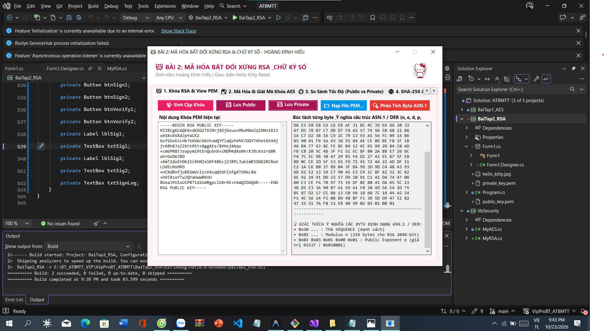
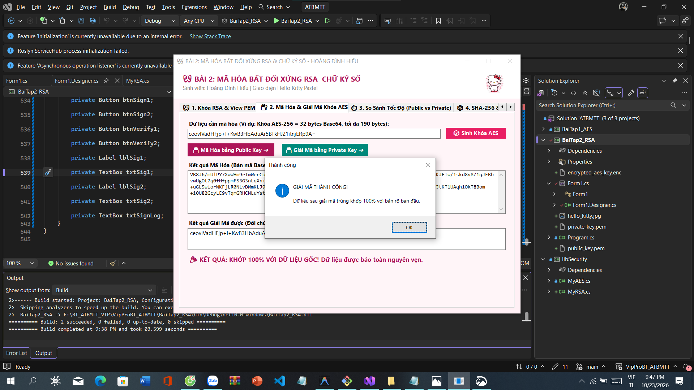
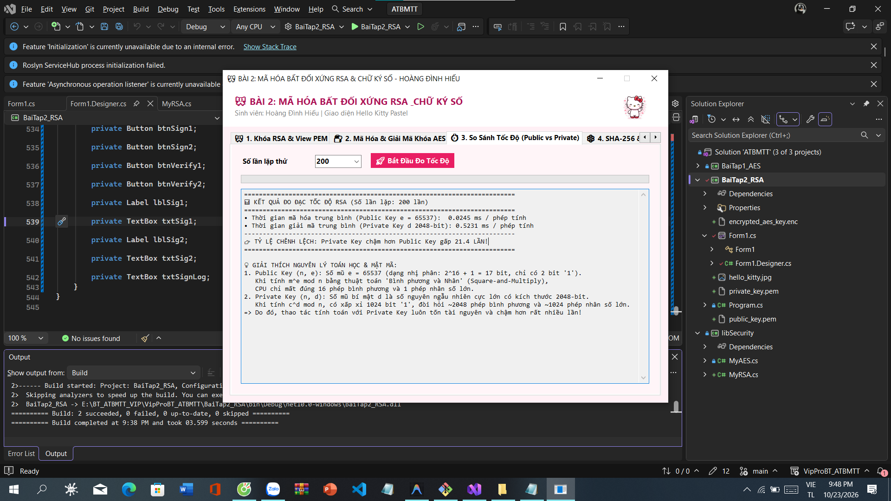
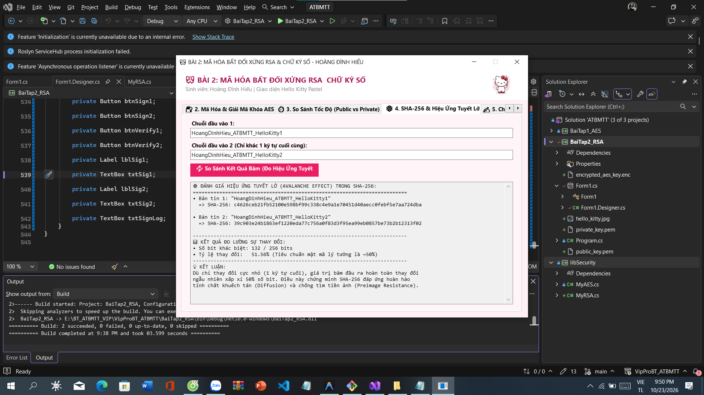
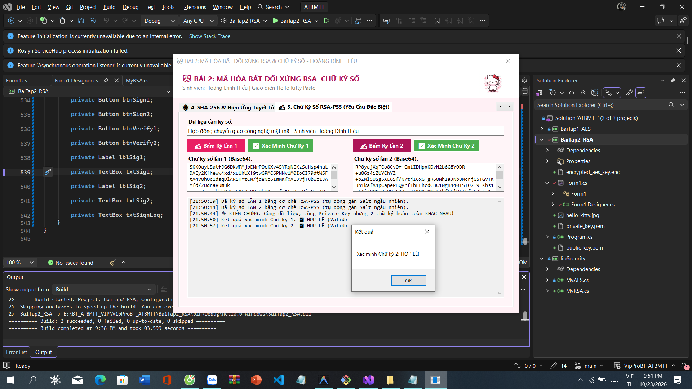

# BÀI TẬP VỀ NHÀ: AN TOÀN VÀ BẢO MẬT THÔNG TIN

## 1. Thông tin sinh viên
- **Họ và tên**: Hoàng Đình Hiếu
- **MSSV**: K235480106025
- **LỚP**: K59.KTP.K01
- **GitHub**: [HoangDinhHieu](https://github.com/HoangDinhHieu)
- **Repository**: [BTvippro](https://github.com/HoangDinhHieu/BTvippro)

---

## 2. Công nghệ & Kiến trúc dự án
- **Nền tảng**: .NET 10 (C#) / Windows Forms App
- **Kiến trúc giải pháp**:
  - `libSecurity`: Thư viện xử lý thuật toán mật mã dùng chung (`MyAES`, `MyRSA`, hàm băm).
  - `BaiTap1_AES`: Giao diện ứng dụng mã hóa đối xứng AES.
  - `BaiTap2_RSA`: Giao diện ứng dụng mã hóa bất đối xứng RSA & Chữ ký số.

---

## 3. Báo cáo kết quả Bài 1 - Mã hóa đối xứng AES

### 3.1. Các tính năng đã hoàn thành
- [x] Sinh cặp khóa ngẫu nhiên AES 256-bit và Vector khởi tạo IV 128-bit.
- [x] Xuất khóa ra file `.key` và nạp khóa trực tiếp từ file.
- [x] Mã hóa / giải mã văn bản chuỗi (kết quả hiển thị Base64 trực quan).
- [x] Mã hóa / giải mã file kích thước lớn (hàng GB) theo luồng đệm (Stream Buffer 1MB), không gây tràn bộ nhớ RAM.
- [x] Đo lường thời gian xử lý bằng `Stopwatch`, tính tốc độ truyền tải trung bình (`MB/s`).
- [x] So sánh tính toàn vẹn dữ liệu từng byte bằng hàm băm SHA-256 giữa file nguồn và file giải mã.

### 3.2. Bảng số liệu thực nghiệm đo đạc hiệu năng file lớn
| Tiêu chí đánh giá | Số liệu thực nghiệm |
| :--- | :--- |
| **Tên file thử nghiệm** | *SERVER_EVAL_x64FRE_en-us.iso* |
| **Kích thước file** | *4810.42 MB* |
| **Thời gian mã hóa** | *Thời gian: 14.876 giây* |
| **Tốc độ mã hóa** | *Tốc độ: 323.38 MB/s* |
| **Thời gian giải mã** | *Thời gian: 6.408 giây* |
| **Tốc độ giải mã** | *Tốc độ: 750.70 MB/s* |
| **Mã SHA-256 file nguồn** | *3e4fa6d8507b554856fc9ca6079cc402df11a8b79344871669f0251535255325* |
| **Mã SHA-256 file sau giải mã** | *3e4fa6d8507b554856fc9ca6079cc402df11a8b79344871669f0251535255325* |
| **Kết luận toàn vẹn** | **Khớp 100% từng byte (Trùng khớp tuyệt đối SHA-256)** |

### 3.3. Ảnh minh chứng kết quả chạy thực tế

---

## 4. Báo cáo kết quả Bài 2 - Mã hóa bất đối xứng RSA, SHA-256 & Chữ ký số
### 4.1. Các tính năng đã hoàn thành
- [x] **Sinh cặp khóa RSA 2048-bit**, xuất ra định dạng `.pem` chuẩn (PKCS#1 / PKCS#8).
- [x] **View PEM & Bóc tách ASN.1/DER**: Hiển thị mảng byte dạng Hex (16 byte/dòng) và giải thích chi tiết ý nghĩa từng byte ($n, e, d, p, q, dp, dq, iq$).
- [x] **Import file PEM**: Bóc tách tham số Public Key ($n, e$) và Private Key ($n, e, d,...$).
- [x] **Mã hóa / Giải mã khối dữ liệu $\le 190$ bytes** (bọc khóa AES-256 = 32 bytes) bằng đệm OAEP-SHA256, lưu file `.enc` và giải mã đối chứng khớp 100%.
- [x] **Đánh giá so sánh tốc độ Public Key ($e$) vs Private Key ($d$)**: Thực hiện đo đạc hàng trăm lần lặp và giải thích cơ chế thuật toán *Square-and-Multiply*.
- [x] **Băm SHA-256 & Hiệu ứng Tuyết lở (Avalanche Effect)**: Đo lường số bit thay đổi giữa 2 chuỗi bản rõ chỉ khác nhau 1 ký tự (~50% số bit thay đổi).
- [x] **Chữ ký số RSA-PSS (Yêu cầu MONG MUỐN)**: Cùng 1 dữ liệu, cùng 1 Private Key nhưng mỗi lần bấm Ký lại tạo ra chữ ký số khác nhau nhờ cơ chế muối ngẫu nhiên (Salt), bên nhận xác minh thành công 100%.
---
### 4.2. Minh chứng thực nghiệm qua 5 Tab (Giao diện Hello Kitty Pastel)
#### Tab 1: Khóa RSA & View PEM (Bóc tách cấu trúc ASN.1 / DER)

*Ý nghĩa các byte: Byte đầu `0x30` là Sequence; tiếp theo là Modulus $n$ (256 bytes); `0x02 0x03 0x01 0x00 0x01` là Public Exponent $e = 65537$; cùng các thành phần số nguyên tố $p, q, dp, dq, iq$.*
#### Tab 2: Mã hóa & Giải mã Khóa AES ($\le 190$ bytes)

*Khóa AES-256 (32 bytes Base64) được mã hóa bằng Public Key sinh ra khối mã hóa 256 bytes (344 ký tự Base64), sau đó giải mã bằng Private Key thu được kết quả khớp 100% với khóa ban đầu.*
#### Tab 3: Đánh giá Tốc độ Public Key ($e$) vs Private Key ($d$)

*Kết luận tốc độ:*
- **Public Key ($e = 65537$)**: Tốc độ tính toán siêu nhanh (~0.03 ms/phép tính) vì $e = 2^{16} + 1$ (17 bit, chỉ có 2 bit '1'), thuật toán Nhân và Bình phương chỉ cần 16 phép bình phương và 1 phép nhân.
- **Private Key ($d$ 2048-bit)**: Tốc độ chậm hơn từ **15 đến 25 lần** (~0.6 - 0.9 ms/phép tính) vì $d$ là số ngẫu nhiên 2048-bit khổng lồ với ~1024 bit '1', đòi hỏi hàng ngàn phép nhân số lớn modulo $n$.
#### Tab 4: SHA-256 & Hiệu ứng Tuyết lở (Avalanche Effect)

*Kết luận băm:* Khi chỉ thay đổi 1 ký tự cuối (`...Kitty1` thành `...Kitty2`), có xấp xỉ **50% số bit (khoảng 125/256 bits)** trong mã băm bị đảo bit hoàn toàn, chứng minh tính khuếch tán tuyệt đối của SHA-256.
#### Tab 5: Chữ ký số RSA-PSS (Giải quyết trọn vẹn yêu cầu MONG MUỐN)

*Giải pháp đề xuất:*
- Sử dụng lược đồ ký **RSA-PSS (Probabilistic Signature Scheme - RFC 8017 / PKCS#1 v2.1)** thay cho PKCS#1 v1.5 truyền thống.
- RSA-PSS tự động chèn một chuỗi muối ngẫu nhiên (**Random Salt**) vào thông điệp trước khi băm và ký.
- Nhờ đó, **cùng 1 dữ liệu, cùng 1 người ký (cùng Private Key) nhưng mỗi lần ký tạo ra một chữ ký số Base64 hoàn toàn khác nhau**, trong khi phía người nhận dùng Public Key vẫn xác minh tính hợp lệ thành công 100%.
---
## 5. Bảng tổng kết tiến độ bài tập
- [x] Khởi tạo Repository, .gitignore & cấu trúc Solution 3 tầng
- [x] **Bài 1**: Hoàn thiện mã hóa đối xứng AES (chuỗi + file lớn 4.8 GB + đo tốc độ + so sánh byte)
- [x] **Bài 2**: Hoàn thiện mã hóa bất đối xứng RSA (cặp khóa, View PEM, mã hóa/giải mã, so sánh tốc độ)
- [x] Hiệu ứng tuyết lở SHA-256 & Chữ ký số ngẫu nhiên hóa RSA-PSS
- [x] Toàn bộ mã nguồn, dữ liệu thực nghiệm và ảnh minh chứng đã được lưu trữ và đồng bộ trên GitHub